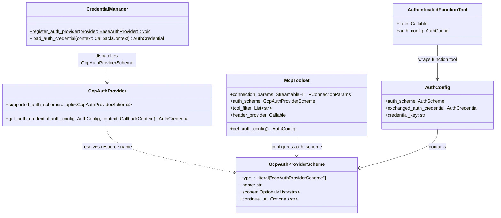
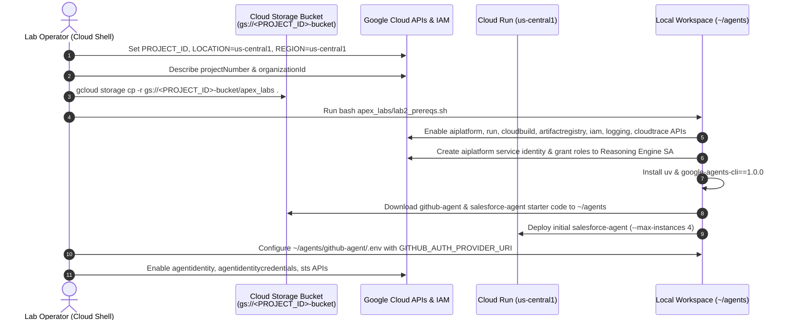
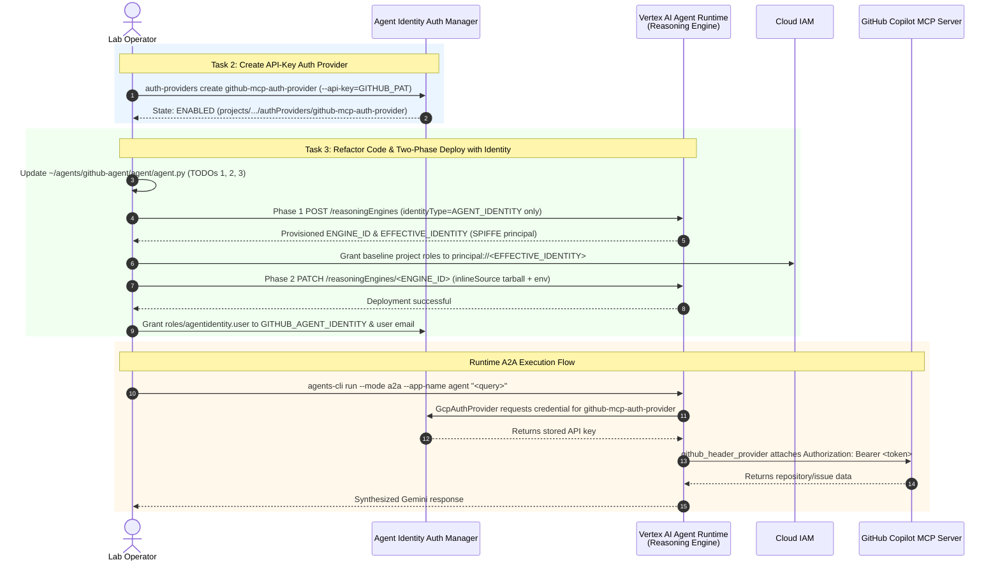
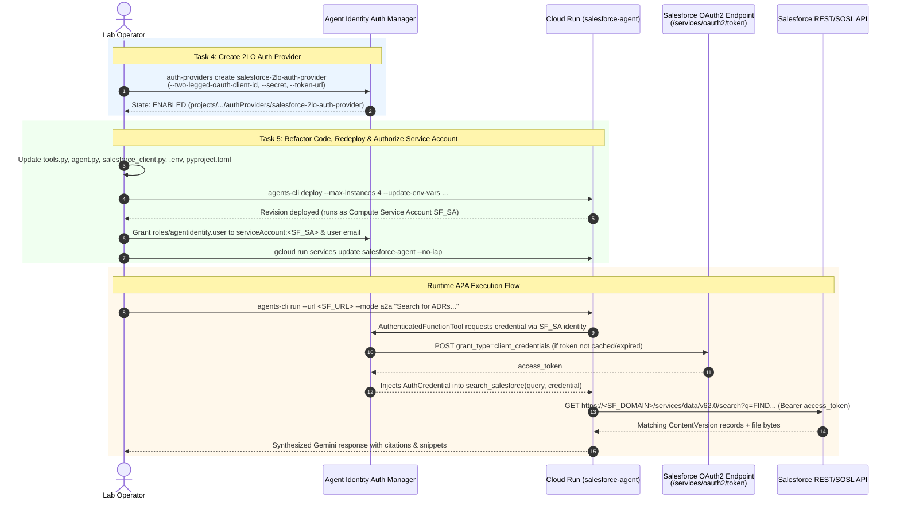

# Agent Identity Foundations (APEX009) — Complete Runbook, HLD, LLD & Workflows

> **Lab URL:** [https://explore.qwiklabs.com/classrooms/21504/labs/115874](https://explore.qwiklabs.com/classrooms/21504/labs/115874)  
> **Lab Title:** Agent Identity Foundations (Lab 2)  
> **Key Technologies:** Google Cloud Agent Identity Auth Manager, Vertex AI Agent Runtime (Reasoning Engine), Cloud Run, Google Agent Development Kit (ADK `v2.4.0`), Model Context Protocol (MCP), Agent-to-Agent (A2A) Protocol, `agents-cli` (`v1.0.0`)

---

## Repository Structure

| File / Directory | Description |
| :--- | :--- |
| [`README.md`](./README.md) | Master document containing Executive Summary, HLD, LLD, Step-by-Step Workflows, and Full Runbook |
| [`docs/HIGH_LEVEL_DESIGN.md`](./docs/HIGH_LEVEL_DESIGN.md) | High-Level Architecture Design (HLD), identity models, and security posture transformation |
| [`docs/LOW_LEVEL_DESIGN.md`](./docs/LOW_LEVEL_DESIGN.md) | Low-Level Design (LLD), ADK class specifications, credential delivery mechanics, and IAM matrix |
| [`docs/WORKFLOWS.md`](./docs/WORKFLOWS.md) | Visual Sequence & State Workflows for every lab task (Tasks 1–5 & Appendix) |
| [`docs/RUNBOOK.md`](./docs/RUNBOOK.md) | Copy-pasteable Step-by-Step Operational Runbook with verification outputs & troubleshooting |
| [`src/github-agent/`](./src/github-agent/) | Refactored GitHub MCP Agent code (`GcpAuthProviderScheme` + `McpToolset` `header_provider`) |
| [`src/salesforce-agent/`](./src/salesforce-agent/) | Refactored Salesforce 2LO Agent code (`AuthenticatedFunctionTool` + credential-free `SalesforceClient`) |

---

## 1. Executive Summary & Lab Objective

In traditional agent deployments (such as the end-state of Lab 1), agents carry raw third-party credentials (e.g., GitHub Personal Access Tokens, Salesforce Connected App Consumer Keys/Secrets) directly in `.env` files or container environment variables. This introduces secret sprawl, rotation overhead, and exposure risks.

This lab refactors two production AI agents to eliminate hardcoded secrets by migrating credential storage and token lifecycle management to **Google Cloud Agent Identity Auth Manager** (`agentidentity.googleapis.com`):

1. **GitHub Specialist Agent (`github-agent`)**:
   - **Runtime:** Vertex AI Agent Runtime (Reasoning Engine)
   - **Identity Type:** Managed **SPIFFE Federated Workload Identity** (`principal://agents.global.org-<ORG_ID>.system.id.goog/...`)
   - **Auth Provider Type:** **API-Key Auth Provider** (`github-mcp-auth-provider`)
   - **Credential Delivery Pattern:** Outgoing HTTP Header interception via `McpToolset(..., header_provider=github_header_provider)` to authenticate against the remote GitHub Copilot MCP Server (`https://api.githubcopilot.com/mcp/`).

2. **Salesforce Specialist Agent (`salesforce-agent`)**:
   - **Runtime:** Google Cloud Run
   - **Identity Type:** **Cloud Run IAM Service Account** (`serviceAccount:<PROJECT_NUMBER>-compute@developer.gserviceaccount.com`)
   - **Auth Provider Type:** **2-Legged OAuth (2LO / Client Credentials) Auth Provider** (`salesforce-2lo-auth-provider`)
   - **Credential Delivery Pattern:** Function argument injection (`credential: AuthCredential`) via `AuthenticatedFunctionTool` to query the Salesforce REST/SOSL API (`ContentVersion` Files search).

---

## 2. High-Level Design (HLD)

### 2.1 Before vs. After Architecture

```mermaid
flowchart TB
    subgraph Before["Before (Lab 1 Starter State — Static Secrets in .env)"]
        direction LR
        GH1["GitHub Agent<br/>(Agent Runtime)"] -->|Reads GITHUB_PERSONAL_ACCESS_TOKEN<br/>from .env| MCP1["GitHub MCP Server"]
        SF1["Salesforce Agent<br/>(Cloud Run)"] -->|Reads CLIENT_ID & SECRET from .env<br/>Runs custom authenticate() & cache| SFAPI1["Salesforce REST/SOSL API"]
    end

    subgraph After["After (Lab 2 Target State — Zero Secrets in Code/Env)"]
        direction LR
        GH2["GitHub Agent v2<br/>(Agent Runtime)<br/>Identity: SPIFFE Principal"] -->|1. Resolve Credential<br/>roles/agentidentity.user| AP_GH["Auth Manager<br/>github-mcp-auth-provider<br/>(API Key)"]
        GH2 -->|2. header_provider injects<br/>Authorization: Bearer| MCP2["GitHub MCP Server"]

        SF2["Salesforce Agent<br/>(Cloud Run)<br/>Identity: Compute SA"] -->|1. Resolve & Refresh 2LO Token<br/>roles/agentidentity.user| AP_SF["Auth Manager<br/>salesforce-2lo-auth-provider<br/>(2-Legged OAuth)"]
        AP_SF <-->|OAuth2 client_credentials grant| SF_TOKEN["Salesforce OAuth2<br/>/services/oauth2/token"]
        SF2 -->|2. AuthenticatedFunctionTool injects<br/>credential: AuthCredential| SFAPI2["Salesforce REST/SOSL API<br/>https://<SF_DOMAIN>"]
    end
```

### 2.2 Core Architectural Pillars

| Dimension | GitHub Agent (`github-agent-v2`) | Salesforce Agent (`salesforce-agent`) |
| :--- | :--- | :--- |
| **Compute Platform** | Vertex AI Agent Runtime (`ReasoningEngine`) | Cloud Run (`run.googleapis.com`) |
| **Workload Identity** | `principal://agents.global.org-${ORGANIZATION_ID}.system.id.goog/resources/aiplatform/projects/${PROJECT_NUMBER}/locations/${REGION}/reasoningEngines/${ENGINE_ID}` | `serviceAccount:${PROJECT_NUMBER}-compute@developer.gserviceaccount.com` |
| **Auth Provider Resource** | `projects/${PROJECT_ID}/locations/${LOCATION}/authProviders/github-mcp-auth-provider` | `projects/${PROJECT_ID}/locations/${LOCATION}/authProviders/salesforce-2lo-auth-provider` |
| **Auth Provider Type** | `--api-key` (Static Bearer Token) | `--two-legged-oauth-*` (OAuth 2.0 `client_credentials`) |
| **ADK Tool Wrapper** | `McpToolset` with `auth_scheme` + `header_provider` | `AuthenticatedFunctionTool` with `AuthConfig` |
| **How Token Reaches Tool** | Callback reads `auth_config` and returns `{"Authorization": "Bearer <token>"}` before each MCP HTTP call | ADK injects `credential: AuthCredential` parameter into `search_salesforce(query, credential)` |
| **Protocol Surface** | A2A (`/a2a/agent/.well-known/agent-card.json`) via dynamic `AgentCardBuilder` | A2A (`/a2a/app/.well-known/agent-card.json`) via scaffolded FastAPI server |

---

## 3. Low-Level Design (LLD)

### 3.1 ADK Pluggable Auth & Credential Resolution Pipeline

Both agents rely on the ADK Pluggable Auth architecture (`google-adk[gcp,agent-identity]==2.4.0`):



### 3.2 Component-Level Design: GitHub Agent (`~/agents/github-agent`)

1. **Environment Configuration (`.env`)**:
   - Retains `GOOGLE_CLOUD_PROJECT`, `GOOGLE_CLOUD_LOCATION=global`, `GOOGLE_GENAI_USE_VERTEXAI=True`, `MODEL=gemini-3.5-flash`, `GITHUB_MCP_URL=https://api.githubcopilot.com/mcp/`.
   - Replaces `GITHUB_PERSONAL_ACCESS_TOKEN` with `GITHUB_AUTH_PROVIDER_URI=projects/${PROJECT_ID}/locations/${LOCATION}/authProviders/github-mcp-auth-provider`.
2. **Import-Time Registration (`agent/agent.py`)**:
   - Calls `CredentialManager.register_auth_provider(GcpAuthProvider())`.
   - Defines `github_auth_scheme = GcpAuthProviderScheme(name=GITHUB_AUTH_PROVIDER_URI)`.
3. **Runtime Header Injection (`github_mcp_toolset()`)**:
   - Because MCP tools are remote HTTP endpoints managed by `McpToolset` rather than local Python functions, credentials cannot be passed as Python function arguments.
   - `github_header_provider(readonly_ctx)` inspects `readonly_ctx.get_credential(auth_config.credential_key)` (or `auth_config.exchanged_auth_credential`), extracts the API key from `cred.http.credentials.token` or `cred.http.additional_headers` (`X-API-Key` / `X-GOOG-API-KEY`), and returns `{"Authorization": f"Bearer {token}"}`.
4. **Two-Phase Deployment (`deploy_with_identity.sh`)**:
   - Vertex AI Agent Runtime rejects single-request creation when `identityType: AGENT_IDENTITY` and `sourceCodeSpec` are combined.
   - **Phase 1 (`POST /v1beta1/projects/{PROJECT_NUMBER}/locations/{REGION}/reasoningEngines`)**: Sends `{"displayName": "github-agent-v2", "spec": {"identityType": "AGENT_IDENTITY"}}` only. Polls LRO until `spec.effectiveIdentity` is provisioned.
   - **Phase 2 (IAM Binding)**: Grants baseline runtime roles (`roles/aiplatform.user`, `roles/agentidentity.user`, `roles/logging.logWriter`, `roles/cloudtrace.agent`, etc.) to `principal://${EFFECTIVE_IDENTITY}`.
   - **Phase 3 (`PATCH /v1beta1/.../reasoningEngines/{ENGINE_ID}?updateMask=...`)**: Packages source code as base64 inline tarball and updates `spec.sourceCodeSpec` and `spec.deploymentSpec` while omitting `identityType` from `updateMask`.

### 3.3 Component-Level Design: Salesforce Agent (`~/agents/salesforce-agent`)

1. **Client Refactoring (`app/salesforce_client.py`)**:
   - Removes `client_id`, `client_secret`, and `authenticate()` from `SalesforceClient`.
   - Derives `self.instance_url = f"https://{self.domain}"` directly in `__init__(self, domain: str, api_version: str | None = None)`.
   - Simplifies `search_files(self, access_token: str, query: str)` and `download_version_text(self, access_token: str, version_id: str, name: str)` to use `self.instance_url`.
2. **Tool Refactoring (`app/tools.py`)**:
   - Registers `CredentialManager.register_auth_provider(GcpAuthProvider())`.
   - Builds `salesforce_auth_config = AuthConfig(auth_scheme=GcpAuthProviderScheme(name=SALESFORCE_AUTH_PROVIDER_URI))`.
   - Changes `search_salesforce(query: str, credential: AuthCredential) -> dict` to receive the resolved `AuthCredential` directly from ADK, extract the OAuth2 access token via `_extract_token(credential)`, and call `client.search_files(access_token, query)`.
   - Wraps `search_salesforce` in `AuthenticatedFunctionTool(func=search_salesforce, auth_config=salesforce_auth_config)`.
3. **Agent Wiring (`app/agent.py`)**:
   - Instantiates `SalesforceClient(domain=SALESFORCE_DOMAIN, api_version=os.environ.get("SALESFORCE_API_VERSION"))` with zero secrets.

### 3.4 IAM Authorization Matrix

| Principal | Target Resource | Role | Purpose |
| :--- | :--- | :--- | :--- |
| `principal://.../reasoningEngines/${GITHUB_ENGINE_ID}` | Auth Provider: `github-mcp-auth-provider` | `roles/agentidentity.user` | Fetch GitHub API key at tool call time |
| `principal://.../reasoningEngines/${GITHUB_ENGINE_ID}` | Project: `${PROJECT_ID}` | `roles/aiplatform.user`, `roles/logging.logWriter`, `roles/cloudtrace.agent`, `roles/monitoring.metricWriter`, `roles/serviceusage.serviceUsageConsumer` | Invoke Gemini model, emit logs/traces, call GCP APIs |
| `serviceAccount:${SF_SA}` | Auth Provider: `salesforce-2lo-auth-provider` | `roles/agentidentity.user` | Fetch refreshed Salesforce 2LO access token |
| `serviceAccount:${SF_SA}` | Project: `${PROJECT_ID}` | `roles/aiplatform.user`, `roles/logging.logWriter`, `roles/cloudtrace.agent`, `roles/serviceusage.serviceUsageConsumer` | Invoke Gemini model, emit logs/traces, call Auth Manager API |
| `user:${USER_EMAIL}` | Both Auth Providers | `roles/agentidentity.user` | Local development & CLI testing |

---

## 4. Step-by-Step Workflows

### Workflow 1: Environment Initialization & Baseline Provisioning (Task 1)



### Workflow 2: GitHub API-Key Auth Provider & Agent Runtime Deployment (Tasks 2 & 3)



### Workflow 3: Salesforce 2LO Auth Provider & Cloud Run Deployment (Tasks 4 & 5)



---

## 5. Step-by-Step Execution Runbook

### Step 1: Set Variables, Download Starter Code & Enable APIs (Task 1)

#### 1.1 Configure Project & Location Variables
```bash
export PROJECT_ID=$(gcloud config get-value project)
export LOCATION=us-central1
export REGION=us-central1
gcloud config set project ${PROJECT_ID}
export PROJECT_NUMBER=$(gcloud projects describe ${PROJECT_ID} --format='value(projectNumber)')
export ORGANIZATION_ID=$(gcloud projects get-ancestors ${PROJECT_ID} --format=json | jq -r '.[] | select(.type=="organization") | .id')
echo "Project: ${PROJECT_ID} (${PROJECT_NUMBER}), Org: ${ORGANIZATION_ID}, Location: ${LOCATION}, Agents: ${REGION}"
```

#### 1.2 Download & Execute Prerequisites Script
```bash
gcloud storage cp -r gs://${PROJECT_ID}-bucket/apex_labs .
bash apex_labs/lab2_prereqs.sh
export PATH="$HOME/.local/bin:$PATH"
```

#### 1.3 Create `.env` for `github-agent` & Verify `agents-cli`
```bash
cd ~/agents/github-agent
cat << EOF > .env
GOOGLE_CLOUD_PROJECT=$PROJECT_ID
GOOGLE_CLOUD_LOCATION=global
GOOGLE_GENAI_USE_VERTEXAI=True
MODEL=gemini-3.5-flash
GITHUB_MCP_URL=https://api.githubcopilot.com/mcp/
GITHUB_AUTH_PROVIDER_URI=projects/$PROJECT_ID/locations/$LOCATION/authProviders/github-mcp-auth-provider
EOF

agents-cli info
```

#### 1.4 Enable Agent Identity & Token Exchange APIs
```bash
gcloud services enable \
  iam.googleapis.com \
  agentidentity.googleapis.com \
  aiplatform.googleapis.com \
  agentidentitycredentials.googleapis.com \
  iamcredentials.googleapis.com \
  sts.googleapis.com \
  --project=${PROJECT_ID}
```

---

### Step 2: Create the GitHub API-Key Auth Provider (Task 2)

```bash
# Store your GitHub PAT securely in a shell variable
read -rs GITHUB_PAT && echo

# Create the API-key auth provider
gcloud alpha agent-identity auth-providers create github-mcp-auth-provider \
  --project=${PROJECT_ID} \
  --location=${LOCATION} \
  --api-key="${GITHUB_PAT}"

# Verify state is ENABLED
gcloud alpha agent-identity auth-providers list \
  --project=${PROJECT_ID} \
  --location=${LOCATION}

# Export the full resource URI
export GITHUB_AUTH_PROVIDER_URI="projects/${PROJECT_ID}/locations/${LOCATION}/authProviders/github-mcp-auth-provider"
echo ${GITHUB_AUTH_PROVIDER_URI}
```

---

### Step 3: Refactor, Deploy & Authorize the GitHub Agent (Task 3)

#### 3.1 Replace `~/agents/github-agent/agent/agent.py` (All 3 TODOs Completed)
See [`src/github-agent/agent/agent.py`](./src/github-agent/agent/agent.py) for the complete file:
- **TODO 1:** `CredentialManager.register_auth_provider(GcpAuthProvider())`
- **TODO 2:** `github_auth_scheme = GcpAuthProviderScheme(name=GITHUB_AUTH_PROVIDER_URI)`
- **TODO 3:**
  ```python
  toolset = McpToolset(
      connection_params=StreamableHTTPConnectionParams(url=GITHUB_MCP_URL),
      auth_scheme=github_auth_scheme,
      tool_filter=GITHUB_TOOL_FILTER,
      header_provider=github_header_provider,
  )
  return toolset
  ```

#### 3.2 Deploy to Vertex AI Agent Runtime with Agent Identity
```bash
cd ~/agents/github-agent
chmod 777 ./deploy_with_identity.sh
REGION=us-central1 A2A_APP_NAME=agent AUTH_PROVIDER_NAME=github-mcp-auth-provider DISPLAY_NAME=github-agent-v2 ./deploy_with_identity.sh
```

#### 3.3 Export Deployed Identity & URL Variables
```bash
export GITHUB_AGENT_IDENTITY="principal://agents.global.org-${ORGANIZATION_ID}.system.id.goog/resources/aiplatform/projects/${PROJECT_NUMBER}/locations/${REGION}/reasoningEngines/${GITHUB_ENGINE_ID}"
export GITHUB_ENGINE_ID="<REASONING_ENGINE_ID_FROM_OUTPUT>"
export GITHUB_AGENT_URL="https://${REGION}-aiplatform.googleapis.com/v1/projects/${PROJECT_NUMBER}/locations/${REGION}/reasoningEngines/${GITHUB_ENGINE_ID}"
echo ${GITHUB_AGENT_URL}
```

#### 3.4 Grant IAM Access on `github-mcp-auth-provider`
```bash
# Grant Agent SPIFFE Principal access
gcloud alpha agent-identity auth-providers add-iam-policy-binding github-mcp-auth-provider \
  --project=${PROJECT_ID} \
  --location=${LOCATION} \
  --role="roles/agentidentity.user" \
  --member="${GITHUB_AGENT_IDENTITY}"

# Grant Lab User access for testing
gcloud alpha agent-identity auth-providers add-iam-policy-binding github-mcp-auth-provider \
  --project=${PROJECT_ID} \
  --location=${LOCATION} \
  --role="roles/agentidentity.user" \
  --member="user:$(gcloud config get-value account)"
```

#### 3.5 Test the Deployed GitHub Agent over A2A
```bash
agents-cli run --url ${GITHUB_AGENT_URL} --mode a2a --app-name agent "List all my open GitHub issues"
agents-cli run --url ${GITHUB_AGENT_URL} --mode a2a --app-name agent "Find the google/adk-python repository"
```

---

### Step 4: Create the Salesforce 2LO Auth Provider (Task 4)

```bash
export SF_DOMAIN="YOUR_SALESFORCE_MY_DOMAIN"   # e.g. yourorg.my.salesforce.com
export SF_CLIENT_ID="YOUR_CONSUMER_KEY"
read -rs SF_CLIENT_SECRET && echo

gcloud alpha agent-identity auth-providers create salesforce-2lo-auth-provider \
  --project=${PROJECT_ID} \
  --location=${LOCATION} \
  --two-legged-oauth-client-id="${SF_CLIENT_ID}" \
  --two-legged-oauth-client-secret="${SF_CLIENT_SECRET}" \
  --two-legged-oauth-token-url="https://${SF_DOMAIN}/services/oauth2/token"

gcloud alpha agent-identity auth-providers list \
  --project=${PROJECT_ID} \
  --location=${LOCATION}

export SALESFORCE_AUTH_PROVIDER_URI="projects/${PROJECT_ID}/locations/${LOCATION}/authProviders/salesforce-2lo-auth-provider"
echo ${SALESFORCE_AUTH_PROVIDER_URI}
```

---

### Step 5: Refactor, Redeploy & Authorize the Salesforce Agent (Task 5)

#### 5.1 Update Code & Configuration Files
- Replace `~/agents/salesforce-agent/app/tools.py` with [`src/salesforce-agent/app/tools.py`](./src/salesforce-agent/app/tools.py).
- Replace `~/agents/salesforce-agent/app/agent.py` with [`src/salesforce-agent/app/agent.py`](./src/salesforce-agent/app/agent.py).
- Update `SalesforceClient` in `~/agents/salesforce-agent/app/salesforce_client.py` with [`src/salesforce-agent/app/salesforce_client.py`](./src/salesforce-agent/app/salesforce_client.py).
- Update `~/agents/salesforce-agent/.env`:
  ```env
  GOOGLE_CLOUD_PROJECT=qwiklabs-gcp-01-ea27a66f2dee
  GOOGLE_CLOUD_LOCATION=global
  GOOGLE_GENAI_USE_VERTEXAI=True
  MODEL=gemini-3.5-flash
  SALESFORCE_DOMAIN=YOUR_SALESFORCE_MY_DOMAIN
  SALESFORCE_AUTH_PROVIDER_URI=projects/qwiklabs-gcp-01-ea27a66f2dee/locations/us-central1/authProviders/salesforce-2lo-auth-provider
  ```

#### 5.2 Add `agent-identity` Dependency & Lock
```bash
cd ~/agents/salesforce-agent
sed -i 's/google-adk\[gcp\]/google-adk[gcp,agent-identity]/' pyproject.toml
uv lock
```

#### 5.3 Redeploy to Cloud Run
```bash
cd ~/agents/salesforce-agent
agents-cli deploy --project ${PROJECT_ID} --region ${REGION} \
  --no-confirm-project \
  --max-instances 4 \
  --update-env-vars "$(grep -v '^#' .env | grep -v '^$' | grep -v '^GOOGLE_CLOUD_PROJECT' | paste -sd,)"
```

#### 5.4 Grant Cloud Run Service Account Access to `salesforce-2lo-auth-provider`
```bash
export SF_SA=$(gcloud run services describe salesforce-agent --region ${REGION} \
  --format='value(spec.template.spec.serviceAccountName)')
echo ${SF_SA}

gcloud alpha agent-identity auth-providers add-iam-policy-binding salesforce-2lo-auth-provider \
  --project=${PROJECT_ID} \
  --location=${LOCATION} \
  --role="roles/agentidentity.user" \
  --member="serviceAccount:${SF_SA}"

gcloud alpha agent-identity auth-providers add-iam-policy-binding salesforce-2lo-auth-provider \
  --project=${PROJECT_ID} \
  --location=${LOCATION} \
  --role="roles/agentidentity.user" \
  --member="user:$(gcloud config get-value account)"
```

#### 5.5 Disable IAP & Test over A2A
```bash
gcloud run services update salesforce-agent --region=${REGION} --no-iap
export SF_URL=$(gcloud run services describe salesforce-agent --region ${REGION} --format='value(status.url)')
agents-cli run --url ${SF_URL} --mode a2a "Search for any architecture decision records about timeouts."
```

---

### Step 6: Appendix — Verify Supporting IAM Grants

```bash
# Confirm GitHub Agent Identity has roles/aiplatform.user, roles/logging.logWriter, roles/cloudtrace.agent
gcloud projects get-iam-policy ${PROJECT_ID} \
  --flatten="bindings[].members" \
  --filter="bindings.members:${GITHUB_AGENT_IDENTITY}" \
  --format="value(bindings.role)"

# Confirm Salesforce Service Account has roles/aiplatform.user, roles/logging.logWriter, roles/cloudtrace.agent
gcloud projects get-iam-policy ${PROJECT_ID} \
  --flatten="bindings[].members" \
  --filter="bindings.members:serviceAccount:${SF_SA}" \
  --format="value(bindings.role)"
```
