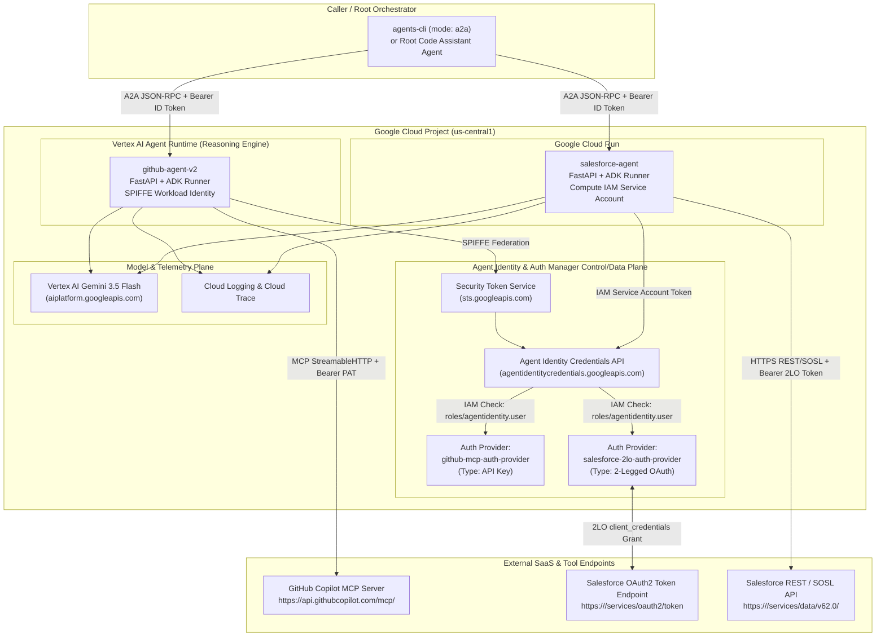

# High-Level Design (HLD) — Agent Identity Foundations (APEX009)

## 1. Architectural Context & Problem Statement

Enterprise multi-agent architectures frequently require specialist sub-agents to interact with third-party SaaS APIs and remote Model Context Protocol (MCP) servers. When credentials (API keys, OAuth client secrets) are baked into agent `.env` files or container environment variables:
- **Secret Sprawl:** Every deployed revision carries raw secrets in runtime environment metadata.
- **Rotation Fragility:** Rotating a GitHub token or Salesforce Consumer Secret requires redeploying all dependent agents.
- **Over-Privileged Access:** Anyone with read access to the compute deployment configuration can inspect the raw secret.
- **Custom Token Plumbing:** Agent developers must write boilerplate OAuth token exchange, TTL caching, and `401` retry logic inside application code.

**Google Cloud Agent Identity Auth Manager** (`agentidentity.googleapis.com` & `agentidentitycredentials.googleapis.com`) solves these challenges by decoupling **Agent Workload Identity** from **External Tool Credentials**.

---

## 2. Target System Architecture

---

## 3. Identity & Authentication Design Comparison

### 3.1 Workload Identity Models

| Attribute | Vertex AI Agent Runtime (`github-agent-v2`) | Cloud Run (`salesforce-agent`) |
| :--- | :--- | :--- |
| **Identity Mechanism** | Managed **SPIFFE Federated Workload Identity** | Google Cloud **IAM Service Account** |
| **Principal Format** | `principal://agents.global.org-<ORG_ID>.system.id.goog/resources/aiplatform/projects/<PROJECT_NUMBER>/locations/<REGION>/reasoningEngines/<ENGINE_ID>` | `serviceAccount:<PROJECT_NUMBER>-compute@developer.gserviceaccount.com` |
| **Provisioning Lifecycle** | Provisioned on ReasoningEngine creation (`spec.identityType = "AGENT_IDENTITY"`) | Attached to Cloud Run revision (`spec.template.spec.serviceAccountName`) |
| **Token Exchange** | Workload Identity Federation via `sts.googleapis.com` | Metadata server OAuth2 access token via `iamcredentials.googleapis.com` |

### 3.2 External Auth Provider Models

| Attribute | API-Key Auth Provider (`github-mcp-auth-provider`) | 2-Legged OAuth Auth Provider (`salesforce-2lo-auth-provider`) |
| :--- | :--- | :--- |
| **Use Case** | Static API key / Personal Access Token | App-only OAuth 2.0 `client_credentials` flow (no end-user consent) |
| **Stored Secrets** | `--api-key` (`GITHUB_PAT`) | `--two-legged-oauth-client-id`, `--two-legged-oauth-client-secret`, `--two-legged-oauth-token-url` |
| **Token Refresh** | N/A (returns static key on demand) | Managed automatically by Auth Manager against `--two-legged-oauth-token-url` |
| **ADK Integration Pattern** | `McpToolset` + `GcpAuthProviderScheme` + `header_provider` callback | `AuthenticatedFunctionTool` + `AuthConfig` + injected `credential: AuthCredential` parameter |

---

## 4. Security & Governance Design

1. **Zero Secret Footprint in Code or Container Env:**
   - Neither `github-agent` nor `salesforce-agent` contains a PAT, consumer key, or consumer secret in `.env`, source files, or container image layers.
   - Only the **Auth Provider URI** (`projects/.../locations/.../authProviders/...`) is stored in `.env`.
2. **Least-Privilege Resource-Level IAM:**
   - Each Auth Provider has its own resource-level IAM policy.
   - `github-agent-v2`'s SPIFFE principal is granted `roles/agentidentity.user` **only** on `github-mcp-auth-provider`.
   - `salesforce-agent`'s Cloud Run service account is granted `roles/agentidentity.user` **only** on `salesforce-2lo-auth-provider`.
3. **Centralized Audit & Revocation:**
   - Every credential resolution call is authenticated and logged via Cloud Audit Logs on `agentidentity.googleapis.com` / `agentidentitycredentials.googleapis.com`.
   - Disabling or rotating an Auth Provider (`gcloud alpha agent-identity auth-providers disable/update`) takes effect immediately without redeploying agent code.
