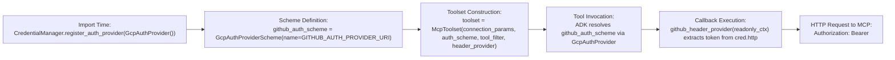

# Low-Level Design (LLD) — Agent Identity Foundations (APEX009)

## 1. Environment & Resource Specifications

| Variable / Resource | Value in Lab Execution | Description |
| :--- | :--- | :--- |
| `PROJECT_ID` | `qwiklabs-gcp-01-ea27a66f2dee` | Target Google Cloud Project ID |
| `PROJECT_NUMBER` | `423033817941` | Numeric project identifier used in SPIFFE principals & service accounts |
| `ORGANIZATION_ID` | `616463121992` | GCP Organization ID used in SPIFFE trust domain (`agents.global.org-<ORG_ID>.system.id.goog`) |
| `LOCATION` / `REGION` | `us-central1` | Region for Auth Providers, Agent Runtime, and Cloud Run |
| `MODEL` | `gemini-3.5-flash` | Vertex AI Gemini model (`GOOGLE_CLOUD_LOCATION=global`) |
| `GITHUB_AUTH_PROVIDER_URI` | `projects/${PROJECT_ID}/locations/us-central1/authProviders/github-mcp-auth-provider` | Resource name of GitHub API-key Auth Provider |
| `SALESFORCE_AUTH_PROVIDER_URI` | `projects/${PROJECT_ID}/locations/us-central1/authProviders/salesforce-2lo-auth-provider` | Resource name of Salesforce 2LO Auth Provider |

---

## 2. Detailed Design — Step-by-Step

### Step 1 (Task 1): Prerequisite Infrastructure & API Enablement

#### Required Google Cloud APIs
- `iam.googleapis.com` & `iamcredentials.googleapis.com`: IAM policy bindings and service account token generation.
- `sts.googleapis.com`: Security Token Service for SPIFFE federated workload identity token exchange.
- `agentidentity.googleapis.com`: Control plane for creating, updating, and binding IAM policies on Auth Providers.
- `agentidentitycredentials.googleapis.com`: Data plane called at runtime by `GcpAuthProvider` to resolve credentials/tokens from Auth Providers.
- `aiplatform.googleapis.com`: Vertex AI Gemini model inference and Vertex AI Agent Runtime (`ReasoningEngine`).
- `run.googleapis.com`, `cloudbuild.googleapis.com`, `artifactregistry.googleapis.com`: Cloud Run container build and deployment.
- `logging.googleapis.com`, `cloudtrace.googleapis.com`: Telemetry and distributed tracing.

---

### Step 2 (Task 2): GitHub API-Key Auth Provider Specification

- **Resource Type:** `agentidentity.googleapis.com/AuthProvider`
- **Resource ID:** `github-mcp-auth-provider`
- **Full Resource Name:** `projects/${PROJECT_ID}/locations/${LOCATION}/authProviders/github-mcp-auth-provider`
- **Configuration Schema:**
  ```yaml
  authProviderTypeParams:
    apiKey: {}   # Stored write-only via --api-key="${GITHUB_PAT}"
  name: projects/<PROJECT_ID>/locations/us-central1/authProviders/github-mcp-auth-provider
  state: ENABLED
  ```

---

### Step 3 (Task 3): GitHub Agent Low-Level Implementation

#### 3.1 Code Structure (`~/agents/github-agent`)
```text
~/agents/github-agent/
├── Dockerfile
├── deploy_with_identity.sh
├── .env
└── agent/
    ├── agent.py          # ADK Agent + McpToolset + GcpAuthProvider + header_provider
    ├── main.py           # FastAPI A2A server using dynamic AgentCardBuilder
    └── requirements.txt  # google-adk[gcp,agent-identity,a2a,mcp]==2.4.0
```

#### 3.2 Credential Resolution & Header Injection Logic (`agent/agent.py`)


- **Why `toolset` Closure Assignment Matters:**
  Inside `github_mcp_toolset()`, `github_header_provider(readonly_ctx)` checks `if not toolset or not toolset.get_auth_config(): return {}`. Therefore, `McpToolset(...)` **must** be assigned to the local `toolset` variable before returning `toolset` so the closure captures the live `McpToolset` instance rather than `None`.

#### 3.3 Two-Step Reasoning Engine Deployment (`deploy_with_identity.sh`)
Because Vertex AI Agent Runtime (`v1beta1`) fails when `spec.identityType="AGENT_IDENTITY"` and `spec.sourceCodeSpec` are submitted in a single `POST` request, `deploy_with_identity.sh` executes two separate REST calls:

1. **Identity Provisioning Call (`POST /v1beta1/projects/${PROJECT_NUMBER}/locations/${REGION}/reasoningEngines`)**:
   ```json
   {
     "displayName": "github-agent-v2",
     "spec": {
       "identityType": "AGENT_IDENTITY"
     }
   }
   ```
   Returns LRO; once complete, `response.spec.effectiveIdentity` yields:
   `agents.global.org-${ORGANIZATION_ID}.system.id.goog/resources/aiplatform/projects/${PROJECT_NUMBER}/locations/${REGION}/reasoningEngines/${ENGINE_ID}`
2. **Code & Env Deployment Call (`PATCH /v1beta1/.../reasoningEngines/${ENGINE_ID}`)**:
   - Query parameter `updateMask`:
     `displayName,spec.sourceCodeSpec.inlineSource.sourceArchive,spec.sourceCodeSpec.imageSpec,spec.deploymentSpec.env,spec.deploymentSpec.minInstances,spec.deploymentSpec.maxInstances,spec.deploymentSpec.resourceLimits,spec.deploymentSpec.containerConcurrency,spec.agentFramework`
   - Deliberately omits `spec.identityType` so the provisioned SPIFFE identity is preserved.

---

### Step 4 (Task 4): Salesforce 2LO Auth Provider Specification

- **Resource Type:** `agentidentity.googleapis.com/AuthProvider`
- **Resource ID:** `salesforce-2lo-auth-provider`
- **Full Resource Name:** `projects/${PROJECT_ID}/locations/${LOCATION}/authProviders/salesforce-2lo-auth-provider`
- **Configuration Schema:**
  ```yaml
  authProviderTypeParams:
    twoLeggedOauth:
      clientId: <SF_CLIENT_ID>
      # clientSecret stored write-only
      tokenUrl: https://<SF_DOMAIN>/services/oauth2/token
  name: projects/<PROJECT_ID>/locations/us-central1/authProviders/salesforce-2lo-auth-provider
  state: ENABLED
  ```

---

### Step 5 (Task 5): Salesforce Agent Low-Level Implementation

#### 5.1 Code Changes Across Modules

| File | Removed (Lab 1 State) | Added / Updated (Lab 2 State) |
| :--- | :--- | :--- |
| `app/salesforce_client.py` | `client_id`, `client_secret`, `authenticate()`, `instance_url` parameters on methods | `self.instance_url = f"https://{self.domain}"`; `download_version_text(access_token, version_id, name)` and `search_files(access_token, query)` |
| `app/tools.py` | `_TOKEN_CACHE_KEY`, `_authenticate_and_cache()`, `_get_token()`, `401` retry loop, `ToolContext` | `CredentialManager.register_auth_provider(GcpAuthProvider())`, `AuthConfig(auth_scheme=GcpAuthProviderScheme(...))`, `_extract_token(credential: AuthCredential)`, `AuthenticatedFunctionTool` |
| `app/agent.py` | `SALESFORCE_CLIENT_ID`, `SALESFORCE_CLIENT_SECRET` env lookups | `SalesforceClient(domain=SALESFORCE_DOMAIN, api_version=...)` |
| `.env` | `SALESFORCE_CLIENT_ID`, `SALESFORCE_CLIENT_SECRET` | `SALESFORCE_AUTH_PROVIDER_URI=projects/.../authProviders/salesforce-2lo-auth-provider` |
| `pyproject.toml` | `google-adk[gcp]` | `google-adk[gcp,agent-identity]` (adds `google-cloud-agentidentitycredentials` & `google-cloud-iamconnectorcredentials`) |

#### 5.2 Token Extraction Logic (`_extract_token` in `app/tools.py`)
`GcpAuthProvider` returns an `AuthCredential` object. `_extract_token(credential)` handles all credential representations returned by Auth Manager:
1. `credential.oauth2.access_token` (standard 2LO OAuth2 token response)
2. `credential.http.credentials.token` (HTTP bearer scheme)
3. `credential.http.additional_headers` (`X-API-Key`, `X-GOOG-API-KEY`, or `Authorization: Bearer ...`)
