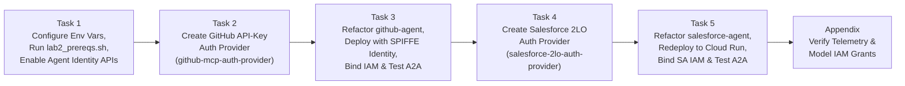
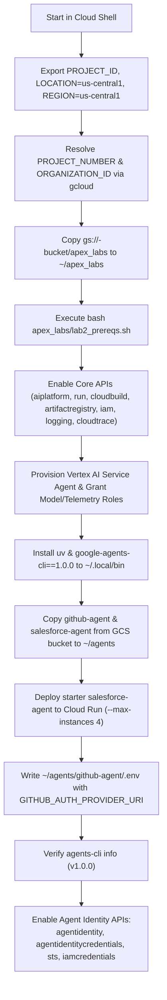
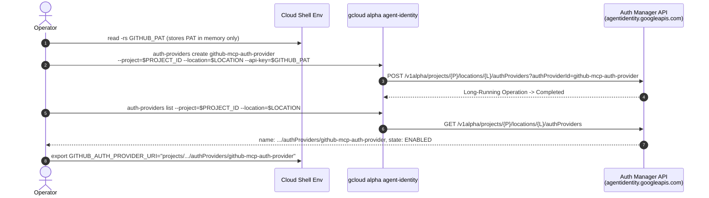
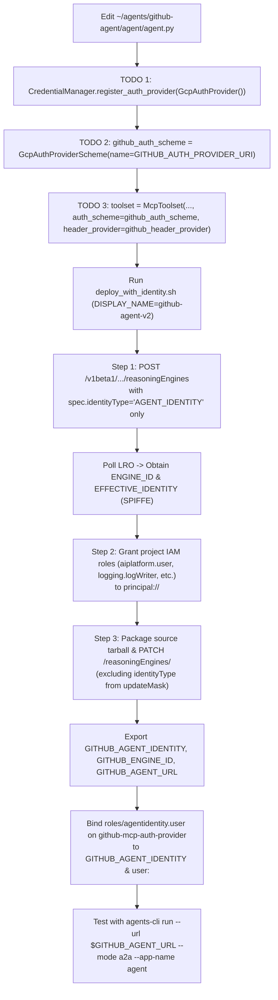
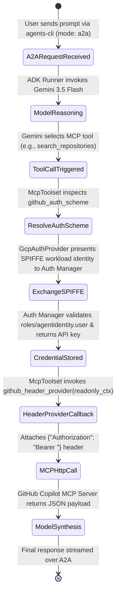
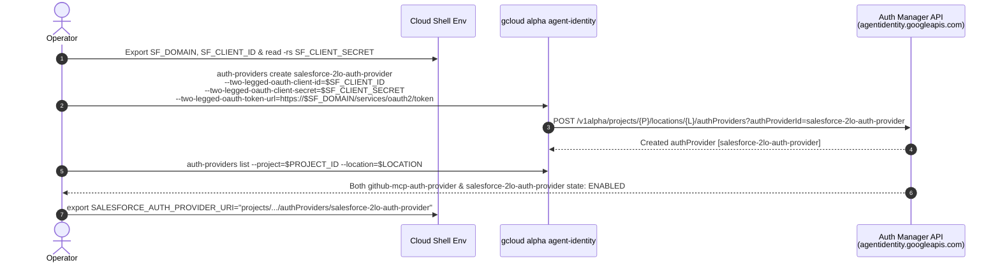
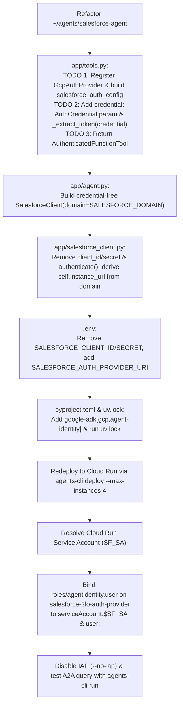
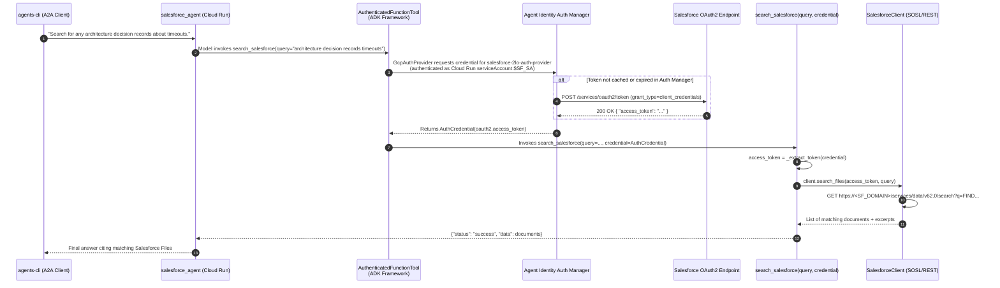

# Step-by-Step Workflows — Agent Identity Foundations (APEX009)

This document provides visual workflow diagrams (control-plane setup and data-plane runtime execution) for every step in Lab **APEX009**.

---

## 1. End-to-End Lab Execution Roadmap

---

## 2. Task 1 Workflow: Environment & Prerequisites Setup

---

## 3. Task 2 Workflow: Creating the GitHub API-Key Auth Provider

---

## 4. Task 3 Workflow: Refactoring & Deploying GitHub Agent with SPIFFE Identity

### 4.1 Deployment & IAM Binding Workflow

### 4.2 Runtime MCP Credential Resolution State Machine

---

## 5. Task 4 Workflow: Creating the Salesforce 2-Legged OAuth Auth Provider

---

## 6. Task 5 Workflow: Refactoring & Redeploying Salesforce Agent on Cloud Run

### 6.1 Code Refactoring & Cloud Run Deployment Workflow

### 6.2 Runtime 2LO Function Tool Credential Injection Flow

